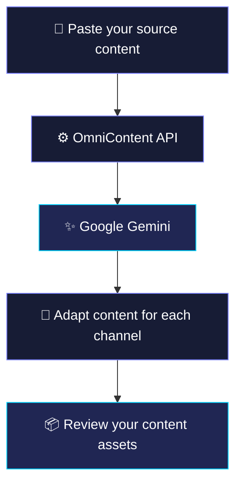

[README.md](https://github.com/user-attachments/files/33282518/README.md)
<div align="center">

<!-- Animated hero: GitHub supports HTML, but not custom CSS/JS. The typing SVG is hosted externally. -->


<p><strong>Turn one piece of long-form content into a complete multi-platform content kit.</strong></p>

<p>
  <a href="https://github.com/GaneshMishra/omnicontent"></a>
  
  
  
</p>

<p>
  <a href="#-why-omnicontent">Why OmniContent</a> ·
  <a href="#-features">Features</a> ·
  <a href="#-how-it-works">How it works</a> ·
  <a href="#-getting-started">Get started</a>
</p>

</div>

---

## ✨ Why OmniContent?

In the creator economy, creating the original content is only the beginning. Adapting it for every platform can mean hours of rewriting, resizing, and restructuring.

**OmniContent** is an AI-powered content repurposing workspace built with **Google Gemini**. Paste a blog post, article, newsletter, or video transcript and transform it into platform-ready content from one unified workflow.

<details open>
<summary><strong>💡 The idea in one sentence</strong></summary>

Write once. Repurpose intelligently. Publish everywhere.

</details>

## 🚀 Features

<table>
<tr>
<td width="50%" valign="top">

### 🧠 AI-powered rewriting
Use Google Gemini to reshape your source material into content tailored to each channel.

</td>
<td width="50%" valign="top">

### 🔁 Multi-platform repurposing
Turn one long-form source into multiple content formats without starting from scratch.

</td>
</tr>
<tr>
<td width="50%" valign="top">

### 🪄 Unified workspace
Keep the content transformation workflow in one clean, focused interface.

</td>
<td width="50%" valign="top">

### 🌌 Animated visual experience
A fluid aurora-style background built with Canvas API and Simplex Noise.

</td>
</tr>
<tr>
<td width="50%" valign="top">

### ⚡ Modern frontend
A responsive React + Vite interface styled with Tailwind CSS and Lucide icons.

</td>
<td width="50%" valign="top">

### 🛡️ Backend prompt handling
An Express API handles AI prompt execution and request validation.

</td>
</tr>
</table>

> **Built for creators, marketers, founders, and teams** who want to spend less time reformatting and more time creating.

## 🔄 How it works



1. **Input** — Paste a blog post, article, newsletter, or transcript.
2. **Process** — The backend validates the request and sends the prompt to Gemini.
3. **Transform** — The AI restructures the source for your chosen content channels.
4. **Review** — Review and refine the generated assets before publishing.

## 🛠️ Tech stack

<table>
<thead>
<tr><th align="left">Layer</th><th align="left">Technology</th><th align="left">Purpose</th></tr>
</thead>
<tbody>
<tr><td><strong>Frontend</strong></td><td><code>React</code> + <code>Vite</code></td><td>Component-based UI and fast development server</td></tr>
<tr><td><strong>UI & styling</strong></td><td><code>Tailwind CSS</code> + <code>Lucide Icons</code></td><td>Responsive styling and crisp iconography</td></tr>
<tr><td><strong>Animation</strong></td><td><code>Simplex Noise</code> + <code>Canvas API</code></td><td>Procedural, fluid aurora-style background effects</td></tr>
<tr><td><strong>Backend</strong></td><td><code>Node.js</code> + <code>Express</code></td><td>REST API, prompt execution, and request validation</td></tr>
<tr><td><strong>AI engine</strong></td><td><code>Google Gemini API</code></td><td>Natural-language content transformation</td></tr>
</tbody>
</table>

## 📦 Getting started

### Prerequisites

- [Node.js](https://nodejs.org/) v18 or higher
- npm (included with Node.js) or Yarn
- A [Google Gemini API key](https://aistudio.google.com/app/apikey)

### 1. Clone the repository

```bash
git clone https://github.com/GaneshMishra/omnicontent.git
cd omnicontent
```

### 2. Configure your environment

Create a `.env` file in the directory read by your backend. If your backend loads the root `.env`, place it in the repository root; otherwise, place it in `/server`.

```ini
GEMINI_API_KEY=your_actual_gemini_api_key_here
PORT=3001
```

<details>
<summary><strong>🔐 API key safety — read before running</strong></summary>

- Keep your Gemini API key on the **server side**.
- Do not put the key in frontend variables such as `VITE_GEMINI_API_KEY`.
- Ensure `.env` is listed in `.gitignore`.
- Never commit your real API key to GitHub.

</details>

### 3. Install and run the backend

From the repository root, install dependencies and run the script configured by your `package.json`:

```bash
npm install
npm run dev
```

### 4. Run the frontend

Open a **second terminal**:

```bash
cd client
npm install
npm run dev
```

Open the local URL shown by Vite—commonly:

**http://localhost:5173**

> **Note:** These commands assume your root and `client` folders define the relevant `dev` scripts. If a command fails, check the scripts in each `package.json`.

## 🗂️ Project structure

```text
omnicontent/
├── client/                 # React + Vite frontend
├── server/                 # Backend (if organized as a separate folder)
├── .env                    # Local environment variables (never commit)
├── .gitignore
└── README.md
```

*Adjust this tree to match the repository's actual folder and file names.*

## 🎨 Design philosophy

- **Focused workflow:** keep the core task—turning source content into useful assets—front and center.
- **Fluid visuals:** an aurora-inspired background gives the workspace a distinctive identity.
- **Clear hierarchy:** use responsive layouts, readable typography, and recognizable icons.
- **AI with a human review step:** generated copy should be checked for accuracy, voice, and platform fit before publishing.

## 🧭 Roadmap

These are potential next steps, not claims that every item is already implemented.

- [ ] Add more configurable platform-specific output presets
- [ ] Add copy-to-clipboard actions for generated assets
- [ ] Add editing and regeneration controls
- [ ] Add export options for content bundles
- [ ] Add source and output history
- [ ] Add tests for API validation and error handling

## 🤝 Contributing

Contributions, suggestions, and bug reports are welcome.

1. Fork the repository.
2. Create a branch: `git checkout -b feature/your-feature`
3. Commit your changes: `git commit -m "Add your feature"`
4. Push the branch: `git push origin feature/your-feature`
5. Open a pull request.

## 🔒 Security

If you discover a security issue, avoid posting secrets or exploit details publicly. Report it privately to the repository maintainer.

## 🏆 Hackathon project

Built with ❤️ for the hackathon.

**Powered by:** Google Gemini · React · Vite · Node.js · Express

<div align="center">


**OmniContent — one source, many possibilities.**

<sub>If this project interests you, consider giving the repository a ⭐ on GitHub.</sub>

</div>
